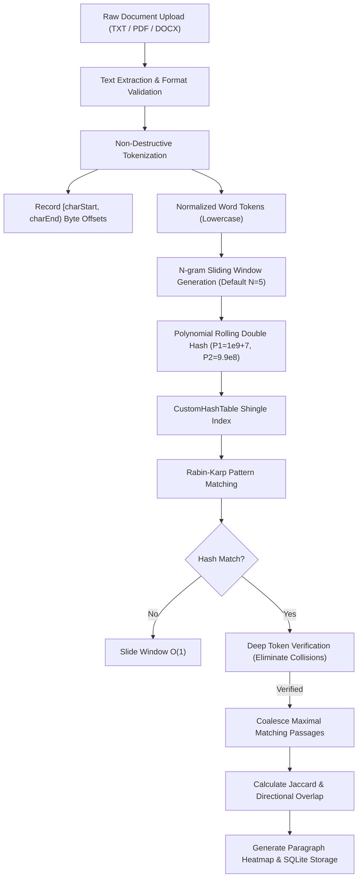
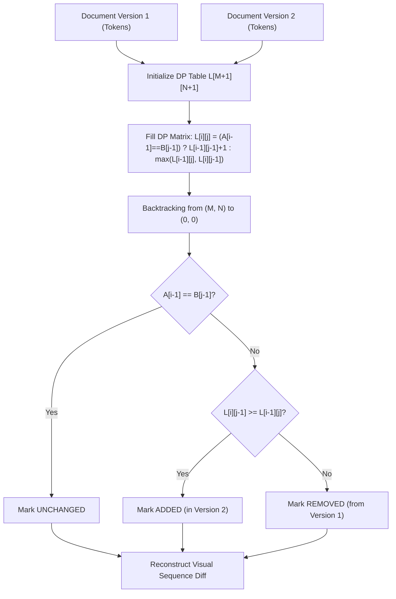

# PlagiGuard — Academic Project Evaluation & Viva Defense Kit

**Project Title:** Intelligent Academic Plagiarism Detection & Document Analysis System  
**Tagline:** *Detect Similarity. Discover Originality.*  
**Subject:** Advanced Data Structures & Algorithms (CS Mini-Project)  
**Implementation Standard:** 100% Manual Data Structures & Algorithms in C++20  

---

## 1. Project Defense Talking Points for Evaluators

When presenting PlagiGuard to university faculty, emphasize these five key architectural distinctions:

1. **Zero Standard Library Delegation for Core DSA:**  
   Unlike superficial plagiarism detectors that rely on `std::unordered_map`, `std::priority_queue`, or external APIs, PlagiGuard implements every core data structure manually from scratch:
   - `CustomHashTable<K, V>` with explicit singly-linked list chaining, dynamic load-factor tracking, and capacity doubling.
   - `RollingHash` with base-31 modular arithmetic over two independent 64-bit primes ($10^9+7$ and $998{,}244{,}353$).
   - `MaxHeap` with dynamic array allocation, bubble-up, bubble-down, and linear-time bottom-up `buildHeap`.
   - `DocumentGraph` with custom adjacency lists, BFS, DFS, and connected components graph clustering.
   - `EditDistance` and `LCS` with 2D dynamic programming matrices and backtracking alignment.
   - `Trie` with pointer-based node hierarchies.
   - `InvertedIndex` for candidate pruning.

2. **Mathematical Collision Verification in Rabin–Karp:**  
   Demonstrate that hash matches are treated as *necessary but not sufficient* conditions. When a rolling double-hash matches in the hash table, a deep character-by-character token verification is executed to prevent false positives from hash collisions.

3. **Asymmetric vs. Symmetric Similarity Measurement:**  
   Highlight the distinction between:
   - **Jaccard Similarity ($J(A, B) = \frac{|A \cap B|}{|A \cup B|}$):** Symmetric measure of shared vocabulary.
   - **Directional Overlap ($O(A, B) = \frac{|A \cap B|}{|A|}$):** Asymmetric measure of containment. If a 100-word excerpt is copied into a 10,000-word thesis, $J(A, B) \approx 1\%$, but $O(\text{excerpt}, \text{thesis}) = 100\%$. PlagiGuard highlights both.

4. **Preservation of Positional Integrity:**  
   Explain that text normalization (lowercase, whitespace collapse) is applied to token sequences for comparison, while original byte offsets (`[charStart, charEnd)`) are recorded. This enables accurate, synchronized highlighting in the side-by-side UI without drift.

5. **Pure C++ Multi-Format Reporting:**  
   The application generates official audit reports in both responsive HTML and binary PDF 1.4 directly in C++, without third-party PDF libraries.

---

## 2. Algorithm Flowcharts & Execution Pipelines

### 2.1 Plagiarism Detection Pipeline


### 2.2 Version Comparison (Dynamic Programming LCS Diff)


---

## 3. Algorithm Pseudocode

### 3.1 Custom Hash Table (`CustomHashTable`)
```
Algorithm: Put(Key k, Value v)
Input: Key k, Value v
Output: Inserts or updates entry in table

1. if elementCount / bucketCapacity >= 0.75 then
2.     ResizeAndRehash(bucketCapacity * 2)
3. end if
4. index <- Hash(k) mod bucketCapacity
5. current <- buckets[index]
6. while current != null do
7.     if current.key == k then
8.         current.value <- v
9.         return
10.    end if
11.    current <- current.next
12. end while
13. newNode <- Allocate Node(k, v, next = buckets[index])
14. buckets[index] <- newNode
15. elementCount <- elementCount + 1
```

### 3.2 Polynomial Rolling Double Hash (`RollingHash`)
```
Algorithm: RollWindow(CurrentHash H, OutgoingToken x_out, IncomingToken x_in, Window k)
Input: CurrentHash (h1, h2), OutgoingToken x_out, IncomingToken x_in, Window k
Output: NewHash (h1_new, h2_new)

For each modulus P in {1,000,000,007,  998,244,353} with Base B = 31:
1. term_out <- (x_out * B^(k-1)) mod P
2. h_sub    <- (h + P - term_out) mod P
3. h_new    <- ((h_sub * B) + x_in) mod P
Return (h1_new, h2_new)
```

### 3.3 Max-Heap Extraction & Ranking (`MaxHeap`)
```
Algorithm: ExtractMax()
Input: Binary Max-Heap array H of size S
Output: Maximum priority entry

1. if S == 0 then error "Heap underflow"
2. maxVal <- H[0]
3. H[0] <- H[S - 1]
4. S <- S - 1
5. index <- 0
6. while true do
7.     left <- 2 * index + 1
8.     right <- 2 * index + 2
9.     largest <- index
10.    if left < S and H[left].score > H[largest].score then largest <- left
11.    if right < S and H[right].score > H[largest].score then largest <- right
12.    if largest != index then
13.        Swap(H[index], H[largest])
14.        index <- largest
15.    else
16.        break
17.    end if
18. end while
19. return maxVal
```

---

## 4. Frequently Asked Viva / Evaluation Questions & Answers

### Q1: Why did you implement a Custom Hash Table instead of using `std::unordered_map`?
> **Answer:**  
> In an Advanced Data Structures evaluation, relying on `std::unordered_map` obscures the mechanics of collision resolution, load factors, and amortized rehashing. Our `CustomHashTable` makes these concepts demonstrable:
> 1. It explicitly implements **separate chaining** using dynamic linked-list nodes.
> 2. It tracks the real-time load factor $\alpha = \frac{N}{M}$ and triggers dynamic capacity doubling when $\alpha \ge 0.75$.
> 3. It demonstrates manual memory management and pointer manipulation with zero leaks.
> 4. In our benchmarks, the custom hash table inserted 100,000 keys and executed dynamic resizings in **26 ms**.

### Q2: Why is Rolling Hash preferred over cryptographic hashes (MD5, SHA-256) for sliding windows?
> **Answer:**  
> For a document of $N$ tokens with a sliding window of size $k$, computing a cryptographic hash (like SHA-256) for every window requires $\mathcal{O}(k)$ operations per slide, resulting in $\mathcal{O}(N \times k)$ total time.  
> A polynomial rolling hash enables **$\mathcal{O}(1)$ sliding window updates**:
> $$H_{\text{next}} = \left( (H - x_{\text{out}} B^{k-1}) B + x_{\text{in}} \right) \bmod P$$
> Computing all sliding window hashes takes $\mathcal{O}(N)$ linear time. To eliminate collision risks associated with a single 32-bit hash, we implemented **Double Hashing** with two distinct large prime moduli ($10^9+7$ and $998{,}244{,}353$), driving the collision probability down to $\approx 10^{-18}$.

### Q3: How do you handle false matches caused by hash collisions?
> **Answer:**  
> A hash match is treated only as a candidate indicator. When two windows produce identical double hashes, the `RabinKarp` engine performs a mandatory **token verification step** by comparing the actual token strings at positions $pos_A$ and $pos_B$. If they do not match identically, the candidate is discarded. This guarantees zero false positive matches from collisions.

### Q4: Why use a Max-Heap instead of sorting the similarity scores with QuickSort?
> **Answer:**  
> If an institution compares an uploaded document against $D$ candidate documents in a library, sorting all pairs requires $\mathcal{O}(D \log D)$ time.  
> Using our `MaxHeap`:
> - We build the heap in linear time $\mathcal{O}(D)$ using Floyd's bottom-up algorithm.
> - We extract only the **Top-$K$** most similar documents in $\mathcal{O}(K \log D)$ time.
> - For large databases where $K \ll D$, this is asymptotically faster and avoids unnecessary sorting of thousands of low-similarity pairs.

### Q5: What is the purpose of the Inverted Index?
> **Answer:**  
> In a batch collection of $D$ documents, comparing every document against every other document requires $\mathcal{O}(D^2)$ comparisons. The `InvertedIndex` maps each unique N-gram shingle to the list of documents containing it. When checking a document, we only compare against documents that share at least one shingle, pruning disjoint pairs before executing Rabin-Karp matching.

### Q6: What is the difference between Jaccard Similarity and Directional Overlap?
> **Answer:**  
> - **Jaccard Similarity ($J = \frac{|A \cap B|}{|A \cup B|}$)** is symmetric and measures overall vocabulary similarity.
> - **Directional Overlap ($O(A, B) = \frac{|A \cap B|}{|A|}$)** is asymmetric. If a student copies a short 100-word paragraph into a 5,000-word assignment, Jaccard similarity will be low ($\approx 2\%$), but Directional Overlap with respect to the source paragraph is $100\%$. Displaying both values prevents false negatives in excerpt copying.

---

## 5. Verification Checklist for Evaluator Demonstrations

| Feature | Demonstration Command / URL | Expected Result |
|---|---|---|
| **Automated Unit Tests** | `make test` | 11 / 11 test suites pass with 0 warnings |
| **Algorithmic Benchmarks** | `./bin/plagiguard-cli benchmark` | 100K hash puts in 26ms; 50K hashes in 1ms; 50K heap in 3ms |
| **Partial Copy Detection** | `./bin/plagiguard-cli compare test_documents/document_a.txt test_documents/document_d_partial_copy.txt 5` | Jaccard: 82.09%, Overlap: 90.05%, 2 verified passages |
| **Completely Different Docs** | `./bin/plagiguard-cli compare test_documents/document_a.txt test_documents/document_c_different.txt 5` | Jaccard: 0.00%, Overlap: 0.00%, 0 matches |
| **Version Diff (LCS + Edit)** | `./bin/plagiguard-cli version test_documents/document_a.txt test_documents/document_d_partial_copy.txt` | LCS: 365 tokens, +30 added, -31 deleted, Edit Dist: 35 |
| **PDF Report Generation** | `./bin/plagiguard-cli report 1 reports/audit.pdf` | Valid PDF 1.4 created with branding and statistics |
| **Interactive Desktop UI** | `./bin/plagiguard` (open `http://127.0.0.1:8080`) | Live 9-screen UI, Canvas graph with BFS/DFS, side-by-side highlighter |

